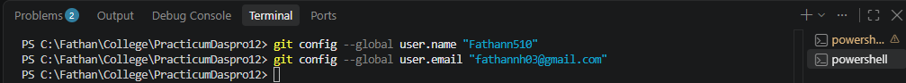

# JOBSHEET 6 - CASE STUDY: SELECTION STRUCTURES WITH GIT AND GITHUB

## Student Identity

- Name: Fathan Nur Hidayat
- Student ID (NIM): 264107020084
- Class / No. Attendance : TI-1I / 30

---

# 1. Objectives

The objectives of this practicum are:

1. Students can solve case studies using basic and nested selection structures.
2. Students can save and submit their work using Git and GitHub through Visual Studio Code.
3. Students can collaborate with classmates using GitHub.

---

# 2. Labs Activities

## 2.1 Initial Setup (Git and GitHub)

This setup is done once on each laptop or PC. The work in this jobsheet is saved and submitted through GitHub. The Git steps (clone, add, commit, push, pull, sync) are done by clicking buttons in Visual Studio Code. Typing commands is only needed once, to set the Git identity.

### 2.1.1 Steps Done

1. Create a GitHub account at github.com, or sign in if the account already exists. The username and email of this account are used in step 4. (To be completed - write the GitHub username here.)
2. Download and install Git from git-scm.com/downloads. The default settings are used, so Git Credential Manager is included and no token is needed.
3. If Visual Studio Code was open before Git was installed, close it and open it again so Git is detected.
4. In Visual Studio Code, open the Terminal menu and choose New Terminal. Then type these two lines one at a time and press Enter after each line. The text in the quotation marks is replaced with my own GitHub username and email.

text
git config --global user.name "Fathann510"
git config --global user.email "fathannh03@gmail.com"


If no message appears after pressing Enter, the setup is successful. This step does not need to be repeated on the same laptop.

### 2.1.2 Running Results / Output Screenshot



---

## 2.2 Experiment 1: Setting Up a Repository

This experiment creates a repository on GitHub, copies it to the computer (clone), and sends the first file to GitHub. The repository name follows the job sheet, PraktikumDaspro plus the attendance number, so the name is PraktikumDaspro30.

### 2.2.1 Steps Done

1. On GitHub, click the + button and choose New repository. The repository name is PraktikumDaspro30, the visibility is Public, and Add README stays Off. Then click Create repository.
2. On the Quick setup page, make sure HTTPS is selected, then click the Copy icon to copy the repository URL.
3. In Visual Studio Code, click Clone Git Repository on the Welcome page, paste the URL, and choose Clone from URL.
4. Choose the destination folder, click Select as Repository Destination, then click Open. If Visual Studio Code asks whether I trust the authors, click Yes, I trust the authors.
5. Create a new file named README.md with the New File icon in the Explorer panel. The file contains one sentence and my personal information (name, student ID, and class). After saving, the file shows the letter U (Untracked).
6. Open Source Control and click the + icon (Stage Changes) next to README.md. This is the Add step. The status changes to A (Added).
7. Write a commit message, for example "Added identity information to README", then click Commit. The commit saves the change in the local repository on my computer.
8. Click the ... icon (More Actions) and choose Push, or click the Publish Branch button. The first time, a GitHub login appears in the browser, and I need to authorize it.
9. Refresh the repository page on GitHub. The README.md file should now be there.

README.md content:

This is my first repository
Name        : Fathan Nur Hidayat
Student ID  : 264107020084
Class       : TI-1I 


### 2.2.2 Running Results / Output Screenshot

[!READMEResult](/READMEResult.png)

Repository link: (https://github.com/Fathann510/PracticumDasproo12)

---

## 2.3 Experiment 2: Case Study 1 - Basic Selection

Kedai Kopi Senja (Senja Coffee Shop) sells Kopi Susu Gula Aren (Palm Sugar Milk Coffee) for
Rp18,000 per cup and gives a 10% discount on purchases of at least Rp100,000. The shop owner needs
a simple cashier program to calculate the total payment and the change. Write a Java program based
on the flowchart below

### 2.3.1 Java Program Code

```java
import java.util.Scanner;

public class CaseStudy112 {
    public static void main(String[] args) {
        Scanner input = new Scanner(System.in);

        System.out.println("--- Welcome to Senja Coffee Shop! ---");

        int pricePerCup = 18000;
        int totalCups, payment, totalPrice, discount, totalPayment, change, less;
        
        System.out.print("Enter the number of cups: ");
        totalCups = input.nextInt();
        System.out.print("Enter the payment amount: ");
        payment = input.nextInt();

        totalPrice = pricePerCup * totalCups;
        discount = 0;

        if (totalPrice >= 100000) {
            discount = ((int) (totalPrice * 0.1));
        }

        totalPayment = totalPrice - discount;

        System.out.println("Total Price: " + totalPrice);
        System.out.println("Discount: " + discount);
        System.out.println("Total Payment: " + totalPayment);

        if (payment >= totalPayment) {
            change = payment - totalPrice;
            System.out.println("Change: " + change);
        } else {
            less = totalPayment - payment;
            System.out.println("Insufficient payment. You need to pay: " + less);
        }
        input.close();
    }
}

```

### 2.3.2 Running Results / Output Screenshot

Example:

[!CaseStudy1Result](/CaseStudy1Result.png)


---

## 2.4 Experiment 3: Case Study 2 - Nested Selection

The Student Affairs Division of Politeknik Negeri Malang gives award funds to students based on the type of activity. For competitions by BELMAWA, BAKORMA, or Mandiri, only the 1st, 2nd, and 3rd place winners get funds. For PKM, funds are given when the proposal is approved for funding. Other activities do not get funds. Students who meet one of the first two conditions must also upload 4 documents. If fewer than 4 documents are uploaded, the data is incomplete and no funds are given. The program only asks for the data that is needed, and it uses nested if with a maximum depth of 3 levels.

### 2.4.1 Java Program Code

```java
import java.util.Scanner;

public class CaseStudy212 {
    public static void main(String[] args) {
        Scanner input = new Scanner(System.in);

        System.out.print("Student Name : ");
        String name = input.nextLine();
        System.out.print("Event Type (BELMAWA/BAKORMA/MANDIRI/PKM/OTHERS) : ");
        String eventType = input.nextLine();

         if (eventType.equalsIgnoreCase("BELMAWA") || eventType.equalsIgnoreCase("BAKORMA") || eventType.equalsIgnoreCase("MANDIRI")) {
            System.out.print("Number of Document : ");
            int documentAmount = input.nextInt();
            System.out.print("Rank : ");
            int peringkat = input.nextInt();

            if (documentAmount < 4) {
                int kurang = 4 - documentAmount;
                System.out.println("Status : Insufficient Document (Need more " + kurang + " documents). The award money is not provided.");
            } else {
                if (peringkat >= 1 && peringkat <= 3) {
                System.out.println("Status : Entitled to receive an award fund (Rank " + peringkat + ").");
                } else {
                System.out.println("Status : Not entitled to receive an award fund " + "(only for ranks 1, 2, or 3).");
                }
            }
        } else if (eventType.equalsIgnoreCase("PKM")) {
            System.out.print("Number of Document : ");
            int documentAmount = input.nextInt();
            System.out.print("Funding Status PKM (1 = approved, 0 = not approved) : ");
            int statusPkm = input.nextInt();

            if (documentAmount < 4) {
                int kurang = 4 - documentAmount;
                System.out.println("Status : Insufficient Document (Need more " + kurang + " documents). The award money is not provided.");
            } else {
                if (statusPkm == 1) {
                    System.out.println("Status : Entitled to receive an award fund " + "(PKM proposal approved and funded).");
                } else {
                    System.out.println("Status : Not entitled to receive an award fund " + "(PKM proposal not approved or funded).");
                }
            }
        } else {
            System.out.println("Status : Not entitled to receive an award fund " + "(event type not included in the regulations).");
        }
        input.close();

    }
}

```

### 2.4.2 Running Results / Output Screenshot

[!CaseStudy2Result](/CaseStudy2Result.png)


---

## 2.5 Experiment 4: Cross-Testing a Classmate's Program

This experiment is done in pairs and in turns. One student is the repository owner and the other is the invited student. The invited student tests the program of the owner with at least 3 test cases and writes the results in README.md. Then the owner pulls the changes and checks the results.

### 2.5.1 Steps Done

Repository owner:

1. On the repository page on GitHub, go to Settings, then Collaborators, then Add people. Type the classmate's GitHub username and click Add to repository.
2. After the classmate has tested the program, pull the changes (... then Pull) or click Sync Changes. Open README.md and check the test results. If a result is wrong, fix the program, then Commit and Push.
3. On GitHub, click the Commits link and make sure the commit of the classmate is in the commit history.

Invited student:

1. Open the invitation email from GitHub and click Accept invitation.
2. Open the classmate's repository page, click the green Code button, choose the HTTPS tab, and copy the URL. Then clone the repository like in Experiment 1.
3. Run StudiKasus2 with at least 3 test cases. Write the results at the bottom of README.md in the format below, then Add and Commit and Push, for example with the message "Test results for SK2 by (name)".

The job sheet gives a note: always Pull before starting work on a shared repository, and the owner should not edit README.md before pulling, so there is no conflict when two people change the same file.

(To be completed - write the GitHub username of the classmate, who tested whose program, and the date.)

### 2.5.2 Running Results / Output Screenshot

> Insert the screenshots here: the collaborator invitation, the clone of the classmate's repository, the test results in README.md, and the commit history. (To be completed - no screenshots have been provided yet.)

The test result format from the job sheet is below. The test data comes from the job sheet. The Output and Correct columns can only be filled after the program is really tested, so they are left open.

text
Test Results for Case Study 2 by <Name>
| No | Type    | Documents | Rank/Funding | Output                                    | Correct? |
|----|---------|-----------|--------------|-------------------------------------------|----------|
| 1  | BAKORMA | 3         | 1            | (to be completed)                         | (to be completed) |
| 2  | Mandiri | 4         | 0            | (to be completed)                         | (to be completed) |
| 3  | pkm     | 4         | 1            | (to be completed)                         | (to be completed) |
| 4  | Lainnya | 4         | not asked    | (to be completed)                         | (to be completed) |


Expected output for each test (from the job sheet, example only): test 1 is documents incomplete with 1 document missing and no award funds; test 2 is not eligible because only 1st, 2nd, and 3rd place get funds; test 3 is eligible because the PKM proposal is approved; test 4 is not eligible because the activity type is not covered by the requirements.